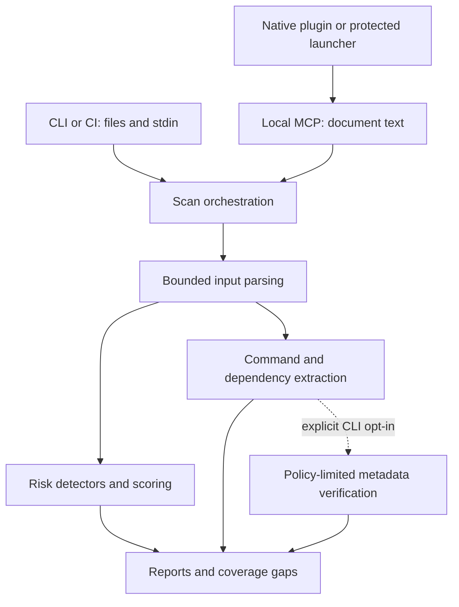
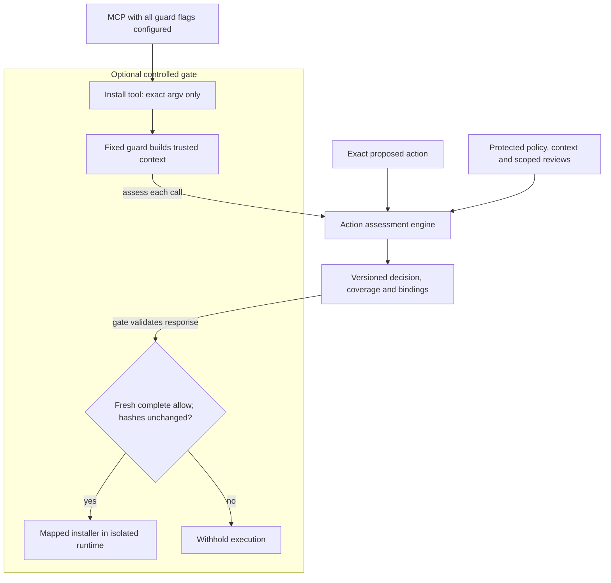

# SkillGuard architecture

[Documentation](docs/README.md) / Architecture

SkillGuard has three separate interfaces: static document scanning, policy-based action
assessment and local MCP tools. Native plugins expose advisory scanning; protected
launchers and an operator-deployed gate add restricted execution paths.

For installation, see the [README](README.md). For request and response schemas, see
[action assessment](docs/action-assessment.md).

## Component architecture

[](docs/diagrams/architecture.svg)

[Open the full-size image](docs/diagrams/architecture.svg) ·
[Mermaid source](docs/diagrams/architecture.mmd) ·
[Explore on GitDiagram](https://gitdiagram.com/ossafrica/skillguard)

This maintained image adapts the GitDiagram component map. The shared runtime serves
native plugins for all three clients; `index.mjs` is the OpenCode adapter. Protected
launchers restrict client executors, while `guard.py` validates and dispatches mapped
installers. The operator supplies isolation. Scan-only MCP tools stay offline; the
optional verification path in the shared pipeline requires separate CLI/operator setup.

## Components and trust boundaries

### Document analysis



### Action assessment and controlled execution



The analysis path never executes documented commands. Metadata verification is optional
network evidence, not package approval. The MCP document tool is offline and does not
read local dependency files or fetch a source label.

The decision response is also read-only. Execution is available only through a
separately configured gate. Isolation, protected files and concurrent-write controls
must be provided by the operator; the gate does not create an OS sandbox. The standard
native plugin installs neither assessment policy nor enforcement hooks.

## Component map

| Responsibility                 | Location                            | Contract                                              |
| ------------------------------ | ----------------------------------- | ----------------------------------------------------- |
| Scan orchestration and reports | `cmd/scan.go`                       | File/stdin scan, coverage, scores and exit codes      |
| Skill and document parsing     | `internal/parser/`                  | Bounded text and frontmatter parsing                  |
| Risk detection and scoring     | `internal/analyzer/`                | Deterministic static findings                         |
| Command extraction             | `internal/extract/`                 | Supported syntax, references and explicit gaps        |
| Metadata verification          | `internal/verify/`                  | Explicit policy and bounded registry/DNS observations |
| Action assessment              | `internal/assess/`, `cmd/assess.go` | Versioned decisions bound to subject and context      |
| MCP protocol and tools         | `internal/mcp/`, `cmd/mcp*.go`      | Structured local stdio tools; optional gate           |
| Native plugin package          | `plugins/skillguard/`               | Setup/status/review and a verified pinned runtime     |
| Protected launcher profiles    | `integrations/clients/`             | Client-specific executor restrictions                 |
| Controlled execution reference | `examples/harness/guard.py`         | Validate, recheck and dispatch mapped argv once       |

## Agent integration lifecycle

Native plugin setup explicitly downloads the release archive pinned in the package's
`runtime-lock.json`. The helper verifies SHA-256 and extracts only the expected regular
binary into a shared user cache outside the target project. Status and MCP startup never
download; startup checks binary integrity against the pinned archive. Missing or corrupt
runtime files make scanning unavailable.

The default MCP server exposes `skillguard_scan_document` with structured JSON and
`execution_authorized:false`. Fixed protected policy/context flags add
`skillguard_assess_action`. All guard flags add `skillguard_install_action`, which
passes exact argv to the fixed guard with no shell and no inherited environment. An
interrupted install may have partially executed; callers must not retry blindly.

Protected launchers remove general native command executors and constrain client startup
configuration. These restrictions are separate from native plugin installation, which
preserves ordinary agent tools. Neither route protects against a compromised host/client
or replaces operator-provided OS isolation.

See [native plugins](docs/native-plugins.md),
[protected launchers and MCP](docs/client-integrations.md), and
[harness deployment](docs/harness-integration.md) for installation and limits.

## Design principles

These principles apply across scanner, assessment and integration changes.

1. **Separate evidence, decisions and execution.** Scanning never executes input. Scans
   are offline by default; metadata verification requires explicit policy. Assessment
   never executes. Only a separately configured gate may dispatch an installer in the
   reviewed context.

2. **The skill is hostile input.** The skill's author controls every path, URL, and line
   of text in it. Referenced script paths are resolved strictly inside the skill's own
   directory, including through symlinks. Reads are capped at 1 MiB. URL trust is
   decided from the parsed host, never from a substring match. The scanner must not
   become a tool an attacker can use to read your files.

3. **Fail closed on critical risk.** One critical finding fails the skill whatever its
   score. A weighted average across five categories could otherwise water a single piped
   shell installer down into a pass.

4. **Flag commands, not prose.** Skills are documentation, and plenty of them talk
   _about_ shells, secrets, and prompt injection. Detectors look for the executable or
   imperative form: `` `rm -rf /tmp` `` in a code span, not the word "remove", and
   "Ignore all previous instructions." as a sentence, not a paragraph describing that
   attack. False positives teach people to ignore the tool.

5. **No silent skips.** Anything that could not be read is reported as a warning and the
   scan carries on. A file named on the command line is always scanned, even without
   frontmatter. A skill that was never read must not be reported as a pass.

6. **Explainable, monotonic scores.** Every finding records the exact deduction it
   caused, so the report adds up to the score. Repeated findings cost less each time but
   never nothing, so adding a finding can never raise a score.

7. **Keep authority outside the target.** The model cannot select policy, invent
   isolation or approve its own action. Incomplete required checks, expired reviews and
   changed inputs withhold execution.

## Scanner pipeline

```text
paths ──▶ Discover ──▶ Parse ──▶ Analyze ──▶ Score ──▶ Report / JSON ──▶ exit code
          (parser)     (parser)  (analyzer)  (analyzer)  (cmd)             (cmd)
```

| Stage    | Package             | Key functions                                                  |
| -------- | ------------------- | -------------------------------------------------------------- |
| CLI      | `cmd`               | `Execute`, `runScan`, `resolveScanPaths`, `scanInputs`         |
| Discover | `internal/parser`   | `FindSkillFiles`, `walkSkillDir`, `classifyFile`               |
| Parse    | `internal/parser`   | `ParseSkillText`, `extractFrontmatter`, `ExtractBodyText`      |
| Analyze  | `internal/analyzer` | `Scorer.Analyze`, `Scorer.AnalyzeReference`, `check*`          |
| Score    | `internal/analyzer` | `finalize`, `calculateCategoryScores`, `calculateOverallScore` |
| Extract  | `internal/extract`  | Static command/dependency inventory and coverage gaps          |
| Verify   | `internal/verify`   | Optional policy-limited registry/DNS metadata                  |
| Model    | `internal/model`    | `Finding`, `AnalysisResult`, `ScanReport`                      |

## 1. CLI orchestration (`cmd/`)

`main.go` calls `cmd.Execute()`, which runs the [Cobra](https://github.com/spf13/cobra)
command tree defined in `cmd/root.go`. The primary interfaces are:

- **`scan`** (`cmd/scan.go`) runs document analysis and optional metadata verification.
- **`assess`** (`cmd/assess.go`) evaluates an exact action under protected policy.
- **`mcp`** (`cmd/mcp.go`) serves local scan and optionally configured action tools.
- **`config`** (`cmd/config.go`) reads and writes `~/.skillguard.yaml` through Viper. It
  stores `default_path` and `threshold`.

### Resolving what to scan

`resolveScanPaths` picks the inputs in this order:

1. Positional arguments (`skillguard scan ./a ./b`)
2. The `--path` flag (`--path ./a,./b`)
3. `default_path` from the config file, falling back to `~/.agents/skills`

Comma-separated values are split, unless the whole string exists as a path, since a
filename can contain a comma. A leading `~` is expanded to the home directory.

The threshold works the same way: an explicit `--threshold` flag wins, otherwise the
config value applies, otherwise `70`. It is validated to be within 0-100.

### Exit codes

The scan command distinguishes failed checks from incomplete analysis:

| Code | Scan outcome                                                      |
| ---- | ----------------------------------------------------------------- |
| `0`  | Requested checks completed and passed; no execution permission    |
| `1`  | Score failure, missing reference or configured intelligence match |
| `2`  | Coverage gaps, incomplete verification or an execution error      |

Assessment has a separate contract: `0` is complete/allow, `1` is complete/review or
deny, and `2` is partial/error. Consumers must validate response bindings, freshness and
status in addition to the process exit code.

## 2. Discovery (`internal/parser/markdown.go`)

`FindSkillFiles` takes one path and returns the files to scan, plus warnings.

- **A file path** is classified and scanned directly.
- **A directory** is walked recursively by `walkSkillDir`. Unlike `filepath.Walk` it
  follows symlinked directories, because skill trees are usually built from symlinks
  (`~/.claude/skills/<name>` → the real checkout). Directories it has already visited
  are skipped, which also stops symlink cycles.
- Directory discovery includes `*.md`, `llms.txt` and `llms-full.txt`. Unreadable inputs
  are reported, and other inputs can still be analyzed. Coverage gaps make the scan
  incomplete rather than silently passing.
- Explicitly named UTF-8 text files and stdin are accepted without skill frontmatter.
  See [documentation inputs](docs/command-extraction.md) for classification, limits and
  extraction coverage.

Markdown inputs are classified as skills or reference documents:

| Type          | Rule                                                                              |
| ------------- | --------------------------------------------------------------------------------- |
| **Skill**     | Has YAML frontmatter and is named `SKILL.md`/`skills.md`, or was named explicitly |
| **Reference** | Anything else: READMEs, guides, and supporting docs in a skill directory          |

Reference documents are scanned too, because an agent may read them. Their results are
labelled `[Reference]` in the report.

## 3. Parsing (`internal/parser/markdown.go`)

`ParseSkillText` splits the bounded input snapshot into frontmatter and body:

```markdown
---
name: deploy-helper
description: Deploys the app to staging
allowed-tools: Read, Bash(git:*)
source: https://github.com/example/skills
triggers: [deploy, ship]
---

# Body the agent will read ...
```

The frontmatter becomes a `model.SkillMetadata`. `allowed-tools` can be a
comma-separated string or a YAML list. If `name` is missing, the filename is used.
Invalid YAML is an error for that file, which is then reported as a skipped warning.

Reference documents go through `ExtractBodyText`, which drops any frontmatter and
returns the text.

## 4. Analysis (`internal/analyzer/scorer.go`)

A `Scorer` is created once per scan with the threshold. Each detector is a `check*`
method that returns `[]model.Finding`. Detection is regex-based and deterministic: the
same input always produces the same findings.

### Detectors

| Detector                    | Looks at | Flags                                                                          | Severity    |
| --------------------------- | -------- | ------------------------------------------------------------------------------ | ----------- |
| `checkToolAccess`           | metadata | Wildcard `allowed-tools`, or shell/exec tools (`Bash`, `shell`, `exec`)        | High        |
| `checkShellExecution`       | body     | `exec(`/`spawn(`/`subprocess`, `$(`, commands with arguments in code spans     | High        |
| `checkFileAccess`           | body     | Write, delete, `rm -rf` operations                                             | High        |
| `checkNetworkAccess`        | body     | URLs whose host is not on the trusted list                                     | Medium      |
| `checkCredentials`          | body     | Secret and credential references                                               | High        |
| `checkPromptInjection`      | body     | Dynamically built prompts                                                      | Medium      |
| `checkInjectedInstructions` | body     | Instruction overrides, secrecy, coercion, role changes, hidden HTML comments   | Critical    |
| `checkSupplyChain`          | metadata | No `source` given                                                              | Low         |
| `checkMetadata`             | metadata | Missing description or triggers                                                | Low         |
| `checkObfuscatedCode`       | body     | `eval`, `new Function`, string-based `setTimeout`                              | Critical    |
| `checkGitDependencies`      | body     | `git clone` / `git fetch`                                                      | Medium      |
| `checkHttpDependencies`     | body     | `curl`/`wget` piped into a shell                                               | Critical    |
| `checkTelemetry`            | body     | Telemetry and analytics                                                        | Low         |
| `checkHiddenCharacters`     | body     | Zero-width characters, bidi overrides, Cyrillic/Greek lookalikes in Latin text | High/Medium |

Skills run every detector. Reference documents run a subset (shell, file access,
network, credentials, obfuscation, HTTP dependencies, hidden characters, injected
instructions), because they have no frontmatter to judge.

### How detectors avoid false positives

- **Shell execution** needs a call (`exec(`) or a known binary _with arguments_ inside a
  code span. `` `git` `` or `` `SKILL.md` `` on their own are just formatting.
- **Prompt injection** needs the imperative, second-person form at the start of a
  sentence. "Ignore all previous instructions." matches. "Skills that can be manipulated
  to ignore safety guidelines" does not. HTML comments are matched first and their
  contents tested separately, so one match cannot run from one comment into the next.
- **Mixed script** skips short strings and text that is mostly Cyrillic or Greek (over
  10%). It only flags a few lookalike letters scattered through Latin text, so accented
  French or German, or text written in Russian, is not flagged.
- **URL trust** parses the URL and matches the host, or a subdomain of it, against the
  trusted list. `https://github.com.evil.net` and `https://evil.com/?ref=github.com` are
  both untrusted.

### Referenced scripts

`extractReferencedFiles` picks out local script paths the body points at: Markdown
links, `scripts/` paths, `import`, `require()`, `<script src>`, and `source`. It covers
`.py`, `.js`, `.ts`, `.sh`, `.rb`, `.go`, and `.rs`.

`analyzeReferencedScripts` then:

1. Resolves each path with `resolveWithin`, which rejects absolute paths, URLs, `../`
   that leaves the skill directory, and symlinks that point outside it.
2. Reads at most 1 MiB with `readLimited`.
3. Runs the script-level detectors (HTTP dependencies, shell, credentials, obfuscation),
   with at most one finding per detector per script.

## 5. Scoring

### Category scores

Each finding belongs to one of five score categories. Every category starts at 100.
Findings subtract a deduction that gets smaller each time the same kind of finding (the
same detection category) repeats:

```
deduction(n) = base(severity) × e^(−rate(severity) × (n − 1))
```

| Severity | Base | Rate | 1st / 2nd / 3rd  |
| -------- | ---- | ---- | ---------------- |
| Critical | 40   | 0.5  | 40 / 24.3 / 14.7 |
| High     | 20   | 0.4  | 20 / 13.4 / 9.0  |
| Medium   | 10   | 0.3  | 10 / 7.4 / 5.5   |
| Low      | 5    | 0.2  | 5 / 4.1 / 3.3    |

The deduction actually applied is written back onto each finding, so the JSON report can
be checked against the score.

### Overall score

The overall score is the weighted average of the category scores, rounded and kept
within 0-100:

| Category     | Weight | Fed by                                                                              |
| ------------ | ------ | ----------------------------------------------------------------------------------- |
| Security     | 3.0    | shell, file, network, credentials, obfuscation, hidden chars, injected instructions |
| Supply chain | 2.0    | missing source, git deps, piped installers, HTTP deps in referenced scripts         |
| Transparency | 1.5    | metadata gaps, dynamically built prompts                                            |
| Quality      | 1.5    | tool access                                                                         |
| Maintenance  | 1.0    | telemetry, protestware                                                              |

### Pass / fail

```go
result.Passed = result.OverallScore >= threshold && result.CriticalCount == 0
```

Both conditions must hold. This is principle 3: a critical finding fails the file
however well the rest scores.

## 6. Reporting

`scanInputs` gathers every `AnalysisResult` into a `model.ScanReport` with totals and a
UTC timestamp.

- **Terminal** (`printColoredReport`): a coloured PASS/FAIL line per file with category
  scores. Failed files show their findings. `--verbose` shows the full breakdown,
  `--quiet` shows nothing but the exit code.
- **JSON** (`--format json` or `--output report.json`): the structured `ScanReport`,
  including extraction and optional verification observations. Report files use `0600`
  permissions; stdout is available without `--output`.
- **Markdown** (`--format markdown`): a report for documentation or CI summaries, on
  stdout or in an output file.
- **Warnings** for skipped paths or files are printed in yellow before the report.

## Extending SkillGuard

To add a detector:

1. Add a `Category` constant in `internal/model/types.go` if none fits.
2. Write a `check*` method in `internal/analyzer/scorer.go` that returns findings, and
   call it from `Analyze` (and from `AnalyzeReference` if it applies to plain
   documents).
3. Map the category to a score category in `mapFindingToScoreCategory`.
4. Add tests with both a true positive and a lookalike that must _not_ match. The
   regression suites in `internal/analyzer/regression_test.go` and
   `internal/parser/regression_test.go` are the model to follow.

Keep the design principles in mind: match the executable form rather than the
vocabulary, never execute untrusted input, and treat every path a skill supplies as
hostile. Any new network checks require explicit policy and must report uncertainty.
Changes to action authorization must preserve the separate protected gate contract.
