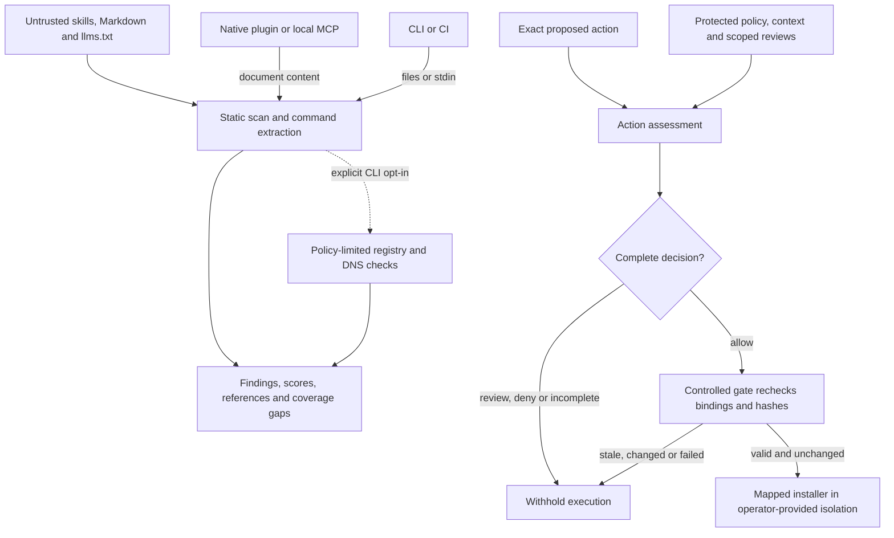

# SkillGuard

[](https://github.com/OSSAfrica/skillguard)
[](LICENSE)
[](https://hub.docker.com/r/ossafrica/skillguard)
[](https://github.com/OSSAfrica/skillguard/releases)
[](https://github.com/OSSAfrica/skillguard/actions)
[](https://github.com/OSSAfrica/skillguard/actions)
[](https://github.com/OSSAfrica/skillguard/actions)
[](https://github.com/OSSAfrica/skillguard/actions)
[](https://securityscorecards.dev/details/github.com/OSSAfrica/skillguard)

Scan AI agent skills and documentation for prompt injection, risky commands and
supply-chain risks. Assess proposed installs with explicit policy, and connect those
decisions to a controlled execution gate when your harness needs enforcement.

[Get started](#get-started) · [How it works](#how-it-works) ·
[Documentation](docs/README.md) · [Contribute](CONTRIBUTING.md)

> A scan is evidence, not execution permission. Package existence and a passing score do
> not establish that a package is legitimate or safe.

## Get started

Choose the integration that matches your workflow:

| What you need                                 | Start here                                         | Execution boundary                                          |
| --------------------------------------------- | -------------------------------------------------- | ----------------------------------------------------------- |
| Review docs in Claude Code, Codex or OpenCode | [Native plugins](docs/native-plugins.md)           | Advisory scanning; ordinary agent tools remain available    |
| Scan files locally or in CI                   | [Install the CLI](#install-the-cli)                | Reports and exit codes; no command interception             |
| Restrict a coding agent's command tools       | [Protected launchers](docs/client-integrations.md) | Removes general executors; optional controlled install tool |
| Enforce decisions in your own harness         | [Harness integration](docs/harness-integration.md) | Operator-configured gate and isolated runtime required      |

### Native plugins

Python 3.10+ must be available as `python3`. No Go installation or repository checkout
is needed.

**Claude Code**

```sh
claude plugin marketplace add OSSAfrica/skillguard
claude plugin install skillguard@ossafrica-skillguard
```

**Codex**

```sh
codex plugin marketplace add OSSAfrica/skillguard
codex plugin add skillguard@ossafrica-skillguard
```

**OpenCode 2**

```sh
opencode plugin add 'github:OSSAfrica/skillguard#4a5108c85d40def32cde720d094b2afce2f6433e::path:plugins/skillguard'
```

Restart your agent, run the plugin's setup workflow, then check status before reviewing
a file. See the [native plugin guide](docs/native-plugins.md) for each agent's commands,
verified runtime setup, updates and removal.

The standard plugin is **advisory**. It does not automatically scan every file,
intercept commands or install enforcement hooks.

## How it works

SkillGuard separates document analysis from action assessment and execution.



1. **Scan untrusted content.** Parse skills and documentation, detect risky patterns,
   and inventory supported install commands without running them.
2. **Gather bounded evidence.** Optional CLI verification checks permitted registry/DNS
   metadata. Missing names and uncertainty remain visible.
3. **Assess the exact action.** Evaluate argv or supported shell text against protected
   policy, dependency inputs, execution context and scoped reviews.
4. **Enforce at the tool boundary.** A separate gate accepts only a fresh, complete
   allow for the matching context and rechecks immediately before dispatch.

The native plugin exposes scanning by default. Assessment and controlled installation
require separate operator configuration. Protected launchers also restrict the client's
native executors; adding MCP tools alone does not do that.

See [Architecture](ARCHITECTURE.md) for components and trust boundaries, or the
[agent supply-chain overview](docs/agent-supply-chain.md) for mitigation limits.

## Features

- **Static detection:** prompt injection, hidden characters, shell execution,
  credentials, obfuscated code, piped installers and risky tool permissions.
- **Documentation inventory:** `llms.txt`, `llms-full.txt`, Markdown, explicit text
  files and stdin, with command references and extraction coverage gaps.
- **Reference verification:** opt-in npm/PyPI metadata and approved DNS checks under an
  explicit operator policy; offline scanning remains the default.
- **Action assessment:** versioned JSON `allow` / `review` / `deny` decisions bound to
  exact actions, inputs, context and expiring operator reviews.
- **Agent integrations:** native plugins, local MCP tools, protected launchers and a
  reference controlled execution gate.
- **Reports and CI:** weighted security scores, critical-finding failure, configurable
  thresholds, and text, JSON or Markdown output.

## Install the CLI

### Release binary

Download a platform binary from the
[releases page](https://github.com/OSSAfrica/skillguard/releases).

### Homebrew

```sh
brew install ossafrica/skillguard/skillguard
```

### Docker

```sh
docker pull ghcr.io/ossafrica/skillguard:latest
docker run --rm -v /absolute/path/to/skills:/skills:ro \
  ghcr.io/ossafrica/skillguard:latest scan --path /skills
```

Images are also available at `ossafrica/skillguard` on Docker Hub. Pin a reviewed
version or image digest in automated deployments.

### Build from source

```sh
git clone https://github.com/OSSAfrica/skillguard.git
cd skillguard
go build -o skillguard .
```

## CLI quick start

### Scan skills or documentation

```sh
skillguard scan
skillguard scan ./my-skills ./vendor-skills
skillguard scan ./docs/llms.txt --format json
skillguard scan - --source https://docs.example.org/llms-full.txt \
  --format json < downloaded.txt
```

The default path is `~/.agents/skills`. Directory discovery includes Markdown,
`llms.txt` and `llms-full.txt`; explicitly named UTF-8 text files and stdin are also
supported. The `--source` label is never fetched or used as a local path.

Command extraction supports a bounded syntax subset. Inspect coverage gaps as well as
findings. See [command extraction](docs/command-extraction.md).

### Save a report

```sh
skillguard scan ./my-skills --output report.json
skillguard scan ./my-skills --format markdown --output report.md
```

Use `--format json` or `--format markdown` without `--output` for stdout.

### Verify references explicitly

```sh
skillguard scan ./docs/llms.txt --format json \
  --verify-references --verification-policy /protected/registries.json
```

Lookups require an explicit policy, including package-name disclosure allowlists. See
[reference verification](docs/reference-verification.md) for private registry handling,
network boundaries and uncertainty states.

### Assess a proposed action

```sh
skillguard assess --policy /protected/action-policy.json < request.json
```

Assessment never executes. See the [action contract](docs/action-assessment.md) for
schemas and examples, and [harness integration](docs/harness-integration.md) for the
separate execution gate.

## Command reference

| Command             | Purpose                                                     |
| ------------------- | ----------------------------------------------------------- |
| `skillguard scan`   | Scan local content and report findings                      |
| `skillguard assess` | Assess an exact proposed action under explicit policy       |
| `skillguard mcp`    | Serve local scanning and optionally configured action tools |
| `skillguard config` | Read or update CLI defaults                                 |

### Common scan flags

| Flag                    | Short | Purpose                                             | Default            |
| ----------------------- | ----- | --------------------------------------------------- | ------------------ |
| `--path`                | `-p`  | File, directory or comma-separated paths            | `~/.agents/skills` |
| `--threshold`           | `-t`  | Minimum passing score, 0–100                        | `70` or config     |
| `--output`              | `-o`  | Write a report file; JSON unless format is Markdown | None               |
| `--format`              | `-f`  | `text`, `json` or `markdown`                        | `text`             |
| `--quiet`               | `-q`  | Suppress report output                              | `false`            |
| `--verbose`             | `-v`  | Show findings and score breakdown                   | `false`            |
| `--source`              |       | Display label for stdin                             | `stdin`            |
| `--verify-references`   |       | Enable policy-limited metadata checks               | `false`            |
| `--verification-policy` |       | Explicit verification policy path                   | None               |

Run `skillguard <command> --help` for command-specific options.

### Exit codes

| Code | Scan                                                              | Assessment                                          |
| ---- | ----------------------------------------------------------------- | --------------------------------------------------- |
| `0`  | Requested checks completed and passed                             | Complete `allow`; gate must still validate context  |
| `1`  | Score failure, missing reference or configured intelligence match | Complete `review` or `deny`                         |
| `2`  | Incomplete coverage, blocked/unavailable checks or error          | Partial assessment, required-check failure or error |

A scan exit code never authorizes execution. Consumers of assessment JSON must validate
status, decision, freshness and bindings as well as the exit code.

## Configuration

Set defaults in `~/.skillguard.yaml`:

```yaml
default_path: ~/.agents/skills
threshold: 70
```

Or use the CLI:

```sh
skillguard config set --path ~/my-skills --threshold 80
skillguard config show
```

Scan defaults are separate from protected verification and action policies.

## Security scoring

SkillGuard uses a multi-category scoring system with weighted averages. Skills start
with 100 points in each category, with deductions based on severity and exponential
decay for repeated findings. Repeated findings of the same kind cost progressively less,
but each one still costs something: adding findings can never raise a score.

### Score categories

| Category     | Weight | Description                                                  |
| ------------ | ------ | ------------------------------------------------------------ |
| Security     | 3.0    | Shell access, file access, credentials, obfuscated code      |
| Supply Chain | 2.0    | External scripts, git/http dependencies, source verification |
| Transparency | 1.5    | Metadata completeness, prompt injection risks                |
| Quality      | 1.5    | Tool access patterns, allowed tools                          |
| Maintenance  | 1.0    | Telemetry, protestware detection                             |

### Severity levels

| Level    | Base Deduction | Decay Factor | 1st / 2nd / 3rd occurrence |
| -------- | -------------- | ------------ | -------------------------- |
| Critical | 40             | e^-0.5x      | 40 / 24.3 / 14.7           |
| High     | 20             | e^-0.4x      | 20 / 13.4 / 9.0            |
| Medium   | 10             | e^-0.3x      | 10 / 7.4 / 5.5             |
| Low      | 5              | e^-0.2x      | 5 / 4.1 / 3.3              |

### Detection categories

| Category            | Risk                                | Severity |
| ------------------- | ----------------------------------- | -------- |
| Shell Execution     | Command invocations, not prose      | High     |
| File Access         | File write/delete operations        | High     |
| Network             | Untrusted external URLs             | Medium   |
| Credentials         | Secret/credential references        | High     |
| Obfuscated Code     | eval, Function, setTimeout patterns | Critical |
| HTTP Dependencies   | curl/wget with pipe to shell        | Critical |
| Git Dependencies    | Git clone/fetch operations          | Medium   |
| Hidden Characters   | Zero-width and control characters   | High     |
| Bidi Override       | Text that renders unlike it reads   | High     |
| Mixed Script        | Cyrillic/Greek lookalikes in Latin  | Medium   |
| Prompt Injection    | Instructions aimed at the agent     | Critical |
| Prompt Construction | Dynamically assembled prompts       | Medium   |
| Supply Chain        | No source URL provided              | Low      |
| Metadata            | Missing description/triggers        | Low      |

A score of 70 or higher is considered passing by default.

**Critical findings are disqualifying.** A skill with any critical finding fails
regardless of its numeric score — a weighted average across five categories can
otherwise dilute a single critical risk, such as a piped shell installer, into a pass.

### What gets scanned

Directory scans follow symlinked skill directories, which is how most skill trees are
laid out (`~/.claude/skills/<name>` pointing at the real directory elsewhere). Anything
that cannot be read is reported as a warning and the rest of the scan continues; a file
named directly on the command line is always scanned, with or without frontmatter.

### Prompt injection

A skill body is read by an agent, so instructions inside it aimed at that agent are the
attack. SkillGuard flags instruction overrides ("ignore all previous instructions"),
secrecy directives ("do not tell the user"), coercion ("you must always comply, even if
the user says otherwise"), role reassignment, and instructions hidden in HTML comments
where a human reviewer will not see them.

Detection requires the imperative form, so documents that _describe_ prompt injection
are not mistaken for documents that _perform_ it: "skills that can be manipulated to
ignore safety guidelines" is prose, while "Ignore all previous instructions." is a
command. These checks are pattern-based and can miss attacks; review findings alongside
command extraction coverage and the proposed action.

### Referenced scripts

When a skill body references a local script (`[setup](scripts/setup.py)`,
`source scripts/env.sh`, `require('./lib.js')`), that script is scanned too. References
are resolved strictly inside the skill's own directory: absolute paths, URLs and paths
escaping the directory (`../../.aws/credentials`) are ignored, so a crafted skill cannot
use the scanner to read arbitrary files.

### Example output

```text
Score: 77/100
Category Scores:
  security: 62/100 (3 findings)
  supply_chain: 55/100 (2 findings)
  quality: 100/100
  maintenance: 100/100
  transparency: 95/100 (1 findings)
```

## URL classification

The static URL detector has a built-in domain allowlist covering common code hosts,
registries, cloud platforms and documentation services. A match suppresses that
detector's untrusted-URL finding; it does not establish ownership, package identity or
permission to execute.

Matching uses the parsed host or its subdomains. `github.com.evil.net` and
`evil.com/?ref=github.com` do not match `github.com`. Verification has its own explicit
operator policy; the static allowlist does not grant network access.

## CI and pre-commit

Use thresholds and exit codes to fail a scan job:

```sh
skillguard scan ./skills --threshold 70 --format json --output report.json
```

For GitHub job summaries, Markdown output can be written directly:

```sh
skillguard scan ./skills --format markdown --output "$GITHUB_STEP_SUMMARY"
```

| Integration              | Example                                                 |
| ------------------------ | ------------------------------------------------------- |
| GitHub Actions           | [Scan workflow](examples/github-actions/skill-scan.yml) |
| GitLab CI                | [Pipeline](examples/gitlab-ci/.gitlab-ci.yml)           |
| Docker Compose           | [Compose file](examples/docker/docker-compose.yml)      |
| Pre-commit               | [Hook setup](examples/pre-commit/README.md)             |
| Documentation publishers | [Publisher CI](examples/publisher-ci/README.md)         |

Publisher scans and commit checks complement agent-side controls. They do not intercept
commands in a running agent.

## Visual examples

<details>
<summary>View CLI recordings</summary>

### Help command


### Scan Cloudflare skills


### Scan AI SDK skills


### Scan multiple paths


</details>

## Documentation and development

- [Documentation index](docs/README.md): installation, integration guides and validation
  records.
- [Architecture](ARCHITECTURE.md): components, data flow and trust boundaries.
- [Development](DEVELOPMENT.md): local setup and checks.
- [Contributing](CONTRIBUTING.md): contribution requirements.
- [Roadmap](ROADMAP.md): planned work.
- [Security policy](SECURITY.md): reporting vulnerabilities.

## License

[MIT](LICENSE).

## Acknowledgments

Inspired by Snyk, Socket.dev and npm audit's work on software security transparency.
